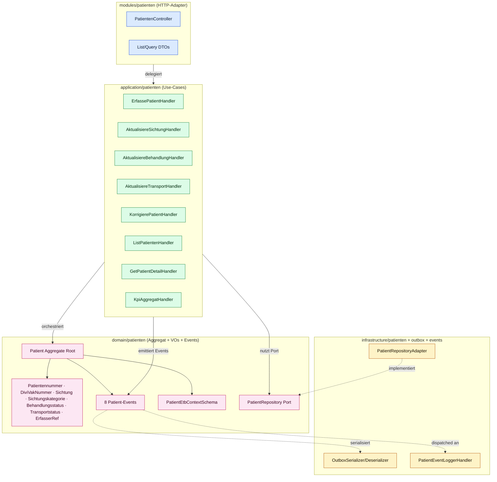
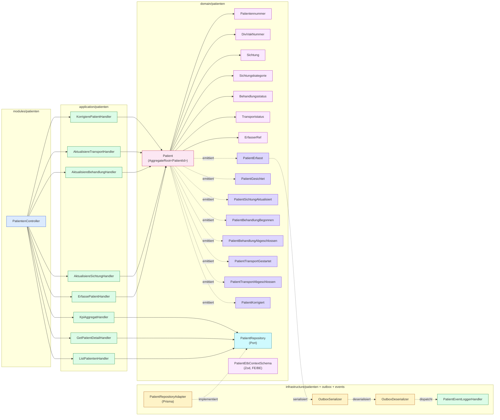
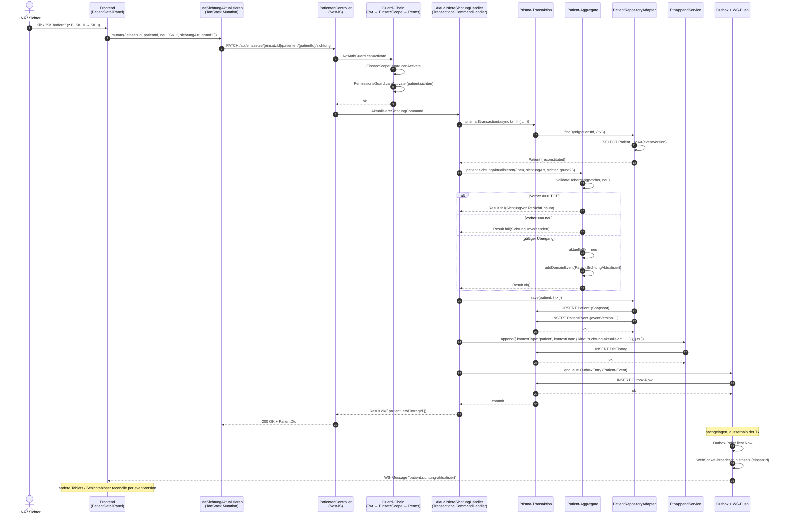

# arc42-Sicht: Patient-Domain-Übersicht

> **Scope:** Diese Sicht dokumentiert die Patient-Domäne (Issue #417, Epic 1) nach Abschluss der Stories 1.1–1.8. Sie ist eine fokussierte arc42-Mini-Sicht (Sections 5, 6, 8) — kein vollständiges arc42-Template für die gesamte Plattform. Letzteres ist ein Folge-Workstream nach dem Pilot.
> **Querverweise:** [ADR-018](../adr/adr-018-patient-aggregat-schema-und-events.md) (Schema-Vertrag), [ADR-005](../adr/adr-005-etb-eintrag-kontext-discriminated-union.md) (ETB-Discriminated-Union), [ADR-012](../adr/adr-012-einsatz-scope-guard.md) (EinsatzScopeGuard), [ADR-015](../adr/adr-015-mdr-grenze-anzeige-ohne-triage-empfehlung.md) (MDR-Grenze), [ADR-016](../adr/adr-016-sk-token-familie-ring-1.md) (SK-Farb-Tokens), [ADR-017](../adr/adr-017-standalone-capture-storage.md) (Standalone-Capture).

---

## Section 5 — Bausteinsicht („Whitebox" Patient-Domain)

### 5.1 Layer-Diagramm

Die Patient-Domäne folgt dem Plattform-Standard der hexagonalen Architektur. Abhängigkeiten fließen **immer nach innen** (`modules → infrastructure → application → domain`). Die Layer-Disziplin wird per `madge` (Circular-Dependency-Check) und `oxlint` (Layer-Restrict-Patterns in `.oxlintrc.json`) erzwungen.



**Regeln (per `oxlint` + `madge` durchgesetzt):**
- `domain/patienten` importiert **kein** NestJS, **kein** Prisma, **kein** HTTP. Reine TypeScript-Domain.
- `application/patienten` nutzt `@Injectable` (CQRS-Handler), kennt das `PatientRepository`-Port-Interface aus `domain/`, kennt aber keine konkrete Prisma-Klasse.
- `infrastructure/patienten` implementiert das Port mit Prisma + `TransactionalCommandHandler`.
- `modules/patienten` ist nur HTTP-Adapter: DTOs → Application-Command/Query, Result → HTTP-Status (via `error-to-http` ([Source: `packages/backend/src/modules/patienten/errors/error-to-http.ts`])).

### 5.2 Komponenten-Diagramm (Detail)



### 5.3 Konkrete File-Pfade

| Komponente | Datei |
|---|---|
| Patient Aggregate Root | `packages/backend/src/domain/patienten/aggregates/patient.aggregate.ts` |
| Value Objects | `packages/backend/src/domain/patienten/value-objects/*.vo.ts` |
| Domain Events | `packages/backend/src/domain/patienten/events/patient-*.event.ts` |
| ETB-Context-Schema (Zod) | `packages/backend/src/domain/patienten/schemas/etb-context.schema.ts` |
| Port: PatientRepository | `packages/backend/src/domain/patienten/repositories/patient.repository.ts` |
| Adapter: Prisma-Repository | `packages/backend/src/infrastructure/patienten/patient-repository.adapter.ts` |
| Infrastructure-Module | `packages/backend/src/infrastructure/patienten/patienten-infrastructure.module.ts` |
| Outbox-Serializer (Patient-Cases) | `packages/backend/src/infrastructure/outbox/event-serializer.ts` (Switch-Case-Block für `patient.*` `eventType`s) |
| Outbox-Deserializer (Patient-Cases) | `packages/backend/src/infrastructure/outbox/event-deserializer.ts` (`eventTypeMap`-Einträge `patient.*`) |
| Event-Adapters-Module | `packages/backend/src/infrastructure/events/event-adapters.module.ts` |
| Event-Logger-Handler | `packages/backend/src/infrastructure/events/handlers/patient-event-logger.handler.ts` |
| Application-Commands | `packages/backend/src/application/patienten/commands/{erfasse-patient,aktualisiere-sichtung,aktualisiere-behandlung,aktualisiere-transport,korrigiere-patient}/` |
| Application-Queries | `packages/backend/src/application/patienten/queries/{list-patienten,get-patient-detail,kpi-aggregat}/` |
| Application-DTOs | `packages/backend/src/application/patienten/dto/*.dto.ts` |
| Controller | `packages/backend/src/modules/patienten/patienten.controller.ts` |
| Frontend-Feature | `packages/frontend/src/features/patienten/` |

### 5.4 HTTP-Schnittstellen (Einsatz-scoped, ADR-012)

Alle Patient-Endpoints sind unter dem **Einsatz-Route-Nesting** verfügbar:

```
/api/einsaetze/:einsatzId/patienten/...
```

Guard-Chain pro Endpoint: `JwtAuthGuard → EinsatzScopeGuard → PermissionsGuard` ([Source: `packages/backend/src/modules/auth/guards/permissions.guard.ts`]).

| Methode | Route | Story | Application-Handler |
|---|---|---|---|
| `POST` | `/api/einsaetze/:einsatzId/patienten` | 1.2 | `ErfassePatientHandler` |
| `PATCH` | `/api/einsaetze/:einsatzId/patienten/:patientId/sichtung` | 1.3 | `AktualisiereSichtungHandler` |
| `PATCH` | `/api/einsaetze/:einsatzId/patienten/:patientId/behandlung` | 1.4 | `AktualisiereBehandlungHandler` |
| `PATCH` | `/api/einsaetze/:einsatzId/patienten/:patientId/transport` | 1.4 | `AktualisiereTransportHandler` |
| `PATCH` | `/api/einsaetze/:einsatzId/patienten/:patientId/korrektur` | 1.4 + 1.7 (`feld='notiz'`) | `KorrigierePatientHandler` |
| `GET` | `/api/einsaetze/:einsatzId/patienten/kpis` | 1.5 | `KpiAggregatHandler` |
| `GET` | `/api/einsaetze/:einsatzId/patienten` | 1.6 | `ListPatientenHandler` |
| `GET` | `/api/einsaetze/:einsatzId/patienten/:patientId` | 1.7 | `GetPatientDetailHandler` |

> **Hinweis zur Route-Reihenfolge:** `GET /kpis` muss im Controller **vor** `GET /:patientId` deklariert werden, sonst greift der Catch-all-Pattern-Match auf den Sub-Pfad. Siehe Kommentar in `patienten.controller.ts`.

Frontend-Routen (Singular, TanStack Router File-based):

```
/app/einsatz/$einsatzId/patienten/...
/app/einsatz/$einsatzId/patienten/$patientId
```

---

## Section 6 — Laufzeitsicht: Sichtungs-Reevaluierung (kritischer Pfad)

Die Sichtungs-Reevaluierung (Story 1.3) ist der lehrreichste Laufzeit-Pfad, weil sie alle vier Schichten in derselben Prisma-Transaktion schreibt und damit die Audit-Konsistenz-Anforderung (NFR-I1 ≥ 99 %, NFR-I2 0 % Snapshot-Drift) explizit macht.



### 6.1 Begründung: alle vier Schichten in derselben Prisma-Transaktion

| Konsistenz-Anforderung | Risiko ohne gemeinsame Tx | Mitigation in dieser Architektur |
|---|---|---|
| **NFR-I1 (Audit ≥ 99 %)** | Patient-Snapshot wird geschrieben, ETB-Eintrag fehlt → Audit-Lücke | UPSERT Patient + INSERT PatientEvent + INSERT EtbEintrag in einer Tx, atomar |
| **NFR-I2 (0 % Snapshot-Drift)** | Patient-Snapshot wird geschrieben, Event-Insert schlägt fehl → Snapshot zeigt zukünftigen Zustand | Beide Inserts in einer Tx; bei Fehler Rollback beider |
| **NFR-R4 (Replay-Konsistenz)** | Outbox-Row ohne korrespondierenden Event → WebSocket sendet, was DB nicht hat | Outbox-Row wird in derselben Tx geschrieben; Poller sieht sie erst nach Commit |
| **Optimistic-Lock (`eventVersion`)** | Race-Condition: zwei Schreiber inkrementieren parallel | `@@unique([patientId, eventVersion])` auf DB-Ebene → 2. Insert schlägt fehl, Application-Layer retry |

**Konsequenz:** `AktualisiereSichtungHandler` erbt von `TransactionalCommandHandler` (`packages/backend/src/application/common/handlers/transactional-command.handler.ts`). Reine `@Injectable()`-Services dürfen weder `PatientEvent` noch `EtbEintrag` direkt schreiben.

### 6.2 Fehlerpfade (Result-Pattern, ADR-018)

Das Aggregat liefert `Result.fail(SentinelError)`, der Handler mappt auf HTTP-Status via `error-to-http.ts`:

| Sentinel | HTTP | Bedeutung |
|---|---|---|
| `BusinessRule:SichtungVonTotNichtErlaubt` | 422 | Patient ist als TOT markiert (irreversible) |
| `BusinessRule:SichtungUnveraendert` | 422 | Idempotenz — gleicher SK-Wert |
| `BusinessRule:GrundUngueltig` | 422 | `grund` Pflicht bei Korrektur, fehlt oder zu kurz |
| `BusinessRule:ClockDriftUngueltig` | 422 | Drift-Marker außerhalb des erlaubten Bereichs |
| `ConflictDetected:PatientEventVersion` | 409 | `eventVersion`-Konflikt — anderer Client war schneller |
| `Invariant:*` | 500 | Aggregat-Invariante verletzt → Bug-Indikator, Logging + Alert |

---

## Section 8 — Querschnittliche Konzepte

### 8.1 Append-only Event-Stream

- **Vertrag:** Patient-Status-Wechsel sind **immer** neue `PatientEvent`-Rows, niemals In-Place-Updates des bestehenden Streams.
- **Korrektur:** Falsche Eingaben werden durch das `patient.korrigiert`-Event überschrieben (mit `vorher`/`neu`/`grund`), der Original-Event bleibt im Stream sichtbar.
- **DB-Invariante:** `@@unique([patientId, eventVersion])` macht doppeltes Schreiben unmöglich (DIN 13050, NFR-S5).
- **Aufbewahrung:** 10 Jahre (DIN-Vorgabe für Sanitätsdokumentation), durch Backup-Strategie sichergestellt — kein TTL-Delete im Modell.

### 8.2 Snapshot-Synchronisation

- **Patient-Tabelle ist denormalisierter Read-Snapshot** für KPI- und Listen-Queries.
- **In derselben Tx geschrieben** wie das jeweilige Event → Snapshot kann nicht drift (NFR-I2).
- **Read-Pfade:** `ListPatientenHandler` (Story 1.6), `GetPatientDetailHandler` (Story 1.7), `KpiAggregatHandler` (Story 1.5) lesen ausschließlich aus dem Snapshot — kein Event-Replay auf dem Lese-Pfad.
- **Reconstitute-Pfad:** `Patient.reconstitute()` baut das Aggregat aus dem Snapshot + `MAX(eventVersion)` zurück — kein Replay nötig.

### 8.3 EinsatzScope-Pflicht (ADR-012)

- **Alle** HTTP-Endpoints unter `/api/einsaetze/:einsatzId/patienten/...` durchlaufen `JwtAuthGuard → EinsatzScopeGuard → PermissionsGuard`.
- **Keine Top-Level-Patient-Routen** (`/api/patienten/...` ist verboten). Begründung: Patient-Daten ohne Einsatz-Kontext sind nicht referenzierbar — jeder Patient gehört zu genau einem Einsatz.
- `EinsatzScopeGuard` prüft, dass der authentifizierte User Mitglied im Einsatz ist (über `EinsatzRollenbesetzung` oder globale `ADMIN`/`SUPER_ADMIN`-Rolle).
- `PermissionsGuard` prüft feingranulare Patient-Permissions (`patient:erfassen`, `patient:sichten`, `patient:behandeln`, `patient:transportieren`, `patient:korrigieren`).

### 8.4 ETB-Verzahnung (ADR-005)

- **Pflichtweg:** Jeder Patient-Vorgang wird mit `kontextType='patient'` und feldweise typisiertem `kontextData` als `EtbEintrag` persistiert.
- **In derselben Tx** wie das `PatientEvent` (siehe 6.1) — keine Out-of-Band-Async-Variante.
- **Single Source of Truth für `kontextData`:** `PatientEtbContextSchema` (Zod) in `domain/patienten/schemas/etb-context.schema.ts`. Frontend (ETB-Filter, Story 1.8) und Backend (Persistenz) konsumieren dasselbe Schema.
- **Filter-Pfad:** ETB-Listen-Query unterstützt `kontextType='patient'` als Filter — patienten-bezogene Einträge sind im ETB sichtbar, aber filterbar isoliert (Story 1.8, F39).
- **Bypass verboten:** Reine `EtbAppendService.append({ kontextType: 'patient' })`-Aufrufe ohne korrespondierendes `PatientEvent` sind ein Code-Smell und werden im Code-Review beanstandet.

### 8.5 MDR-Grenze (ADR-015)

- **`aktuelleSk` reflektiert nur menschliche Sichtungs-Entscheidungen** — keine algorithmischen Empfehlungen, keine ML-Vorschläge, keine Score-Berechnungen.
- **TOT-Markierung** ist ein irreversibles regulatorisches Statement (DIN 13050). `korrigieren(feld='sichtung', neu='TOT')` ist nur mit explizitem `bestaetigeTotKorrektur=true` zulässig. Frontend zeigt eine harte Confirm-Schranke (Story 1.4 Code-Review Feature 2).
- **Keine Triage-Recommender-Endpoints.** Selbst wenn fachlich sinnvoll, würde das in den MDR-Geltungsbereich fallen — explizit aus dem Scope der Plattform ausgeschlossen.
- **Konsequenz fürs Schema:** Es gibt keine `score`, `risikoIndex`, `triageEmpfehlung`-Spalten in `Patient` oder `PatientEvent`. Beobachtungs-Daten (Atemfrequenz, Bewusstsein) gehören in den ETB-Kontext, nicht in den Patient-Snapshot.

### 8.6 Standalone-Capture-Integration (ADR-017)

- `ErfasserRef` als Discriminated Union erlaubt drei Aktoren-Typen: `user` (eingeloggter Anwender), `device` (Tablet ohne User, vor Einsatz-Eröffnung), `session` (Capture-Session-ID).
- Standalone-Capture (Folge-Epic 2) erzeugt lokale `patient.erfasst`-Events mit `erfasserRef.type='device'` und `originSessionId`.
- Beim Anhängen an einen Einsatz mappt das Backend die lokalen CUIDs auf Backend-CUIDs (ADR-017 §4) und schreibt die lokalen Events 1:1 in den Backend-Stream. Schema bleibt unverändert.

### 8.7 Frontend-Feature-Struktur

Die Patient-Feature folgt der Plattform-Konvention (`packages/frontend/src/features/patienten/`):

```
patienten/
├── api/              ← TanStack-Query-Hooks + PATIENT_QUERY_KEYS (feature-lokal!)
├── constants/        ← PATIENT_PHASES für EntityFlowStrip
├── ui/
│   ├── patientendashboard.organism.tsx   ← D1/D3-Komposition
│   ├── patientenliste.organism.tsx       ← virtualisierte Tabelle (Story 1.6)
│   ├── patient-detail-panel.organism.tsx ← Split-View / Drawer (Story 1.7)
│   ├── patient-ereignis-liste.organism.tsx
│   ├── patient-pill.molecule.tsx
│   ├── patient-list-row.molecule.tsx
│   ├── kpi-strip.tsx                     ← Story 1.5
│   ├── sk-badge.tsx / sk-selector.tsx / sk-upgrade-pill-group.tsx
│   ├── behandlungs-status-pill-group.tsx
│   ├── transport-status-pill-group.tsx
│   ├── erfasse-patient-drawer.molecule.tsx + erfasse-patient-form.tsx
│   ├── korrektur-drawer.tsx
│   └── patient-notiz-feld.molecule.tsx   ← Story 1.7 Auto-Save
├── utils/            ← get-patient-phase
└── __tests__/        ← Organism-Tests, Responsive-/A11y-Specs
```

Die Komponenten sind atomic-design-organisiert (`*.atom.tsx` / `*.molecule.tsx` / `*.organism.tsx`), Routes liegen file-based unter `src/routes/app/einsatz/$einsatzId/patienten/`.

### 8.8 Tests & Audit-Gates

- **Domain-Coverage:** ≥ 80 % Statements auf `domain/patienten/` (NFR-M5). Domain-Tests in `__tests__/`-Verzeichnissen pro Sub-Modul, ohne Prisma- oder NestJS-Imports.
- **Architektur-Checks (NFR-M6):** `pnpm --filter @bluelight-hub/backend check:arch` (Circular-Deps via `madge`), `check:di:imports` (kein `import type` für `@Injectable`-Klassen).
- **Frontend-A11y:** axe-core über `PatientenDashboard`-D1/D4-Layouts (Story 1.9, NFR-A1 BITV 2.0). Helper: `packages/frontend/src/test/a11y.ts`.
- **Frontend-Responsive:** Render-Smoke über 320/640/1024/1280/1440 px (UX-DR33). Vorbild: `AmpelDashboard.responsive.spec.tsx`.
- **Outbox-Roundtrip:** Pro Patient-Event ein Test, der Serializer + Deserializer in derselben Spec abdeckt.

### 8.9 Konsens-Naming

Bei Konflikten zwischen Story-Spec-Naming und UI-Implementation gewinnt **UI-Naming**. Konkret (ADR-018):

- `KpiStrip` (nicht `KpiTile`/`KpiCard` als Top-Level)
- `PatientenListe` (nicht `PatientList`)
- `PatientDetailPanel`
- `PatientPill`
- `EntityFlowStrip`
- `PatientenDashboard`

Diese Namen sind Pflicht in arc42-Sichten, ADRs und neuen Stories.

---

## Anhang: Pflege-Hinweise

- **Diagramme:** Mermaid-Syntax-Check vor Commit (z. B. via VS Code Markdown Preview Mermaid Support). Beim Editor-Wechsel auf andere Mermaid-Renderer prüfen.
- **File-Pfade:** Bei Re-Strukturierungen ist Section 5.3 als Single Source of Truth zu aktualisieren. Diese Sicht spiegelt den Stand nach Story 1.8 (2026-05-22).
- **Erweiterung um neue Sichten:** Folge-Sichten (`docs/architecture/<feature>-overview.md`) folgen demselben Muster (Section 5/6/8). Vollständiges arc42 (Section 1–12) ist Post-Pilot-Workstream.
